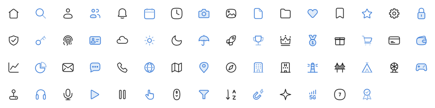

  <a href="https://www.fosicons.com">
    <picture>
      <source media="(prefers-color-scheme: dark)" srcset="fos-mark-dark.svg">
      
    </picture>
  </a>

<h3 align="center">Fos Icons</h3>

  1,500+ open-source icons in Regular, Solid, Duocolor, and Duotone, drawn on one 24px grid. 
  <a href="https://www.fosicons.com">Website</a> ·
  <a href="https://github.com/fos-icons/fos-icons">Library</a> ·
  <a href="https://github.com/fos-icons/fos-icons/tree/main/packages">Packages</a> ·
  <a href="https://www.fosicons.com/ai-agents">AI agents</a>

  <a href="https://www.fosicons.com">
    <picture>
      <source media="(prefers-color-scheme: dark)" srcset="preview-dark.svg">
      
    </picture>
  </a>

## Packages

| Framework | Package | Source |
| --- | --- | --- |
| React | `@fos-icons/react` | [packages/react](https://github.com/fos-icons/fos-icons/tree/main/packages/react) |
| Vue | `@fos-icons/vue` | [packages/vue](https://github.com/fos-icons/fos-icons/tree/main/packages/vue) |
| Svelte | `@fos-icons/svelte` | [packages/svelte](https://github.com/fos-icons/fos-icons/tree/main/packages/svelte) |
| SolidJS | `@fos-icons/solid` | [packages/solid](https://github.com/fos-icons/fos-icons/tree/main/packages/solid) |
| Angular | `@fos-icons/angular` | [packages/angular](https://github.com/fos-icons/fos-icons/tree/main/packages/angular) |
| Flutter | `fos_icons` | [packages/flutter](https://github.com/fos-icons/fos-icons/tree/main/packages/flutter) |

## AI agents

A free MCP server at `https://www.fosicons.com/mcp` lets coding agents search the
library and write exact imports. Setup for every client is at
[fosicons.com/ai-agents](https://www.fosicons.com/ai-agents).

| Client | Install | Source |
| --- | --- | --- |
| Claude Code | `/plugin marketplace add fos-icons/fos-icons`, then `/plugin install fos-icons@fos-icons` | [plugins/claude](https://github.com/fos-icons/fos-icons/tree/main/plugins/claude) |
| Codex | `codex plugin marketplace add fos-icons/fos-icons`, then `codex plugin add fos-icons@fos-icons` | [plugins/openai](https://github.com/fos-icons/fos-icons/tree/main/plugins/openai) |
| Cursor | Add the MCP server, plus the `fos-icons.mdc` rule in `.cursor/rules/` | [plugins/cursor](https://github.com/fos-icons/fos-icons/tree/main/plugins/cursor) |
| Agent Skills | `npx skills add fos-icons/fos-icons` | [skills](https://github.com/fos-icons/fos-icons/tree/main/skills) |

## Plugins

| Plugin | Source |
| --- | --- |
| Framer | [plugins/framer](https://github.com/fos-icons/fos-icons/tree/main/plugins/framer) |

## Get involved

[Request an icon](https://github.com/fos-icons/fos-icons/issues/new) or browse the
[design principles](https://github.com/fos-icons/fos-icons/blob/main/ICON_STYLE_PRINCIPLES.md).
Fos Icons is MIT licensed; brand marks belong to their owners.
